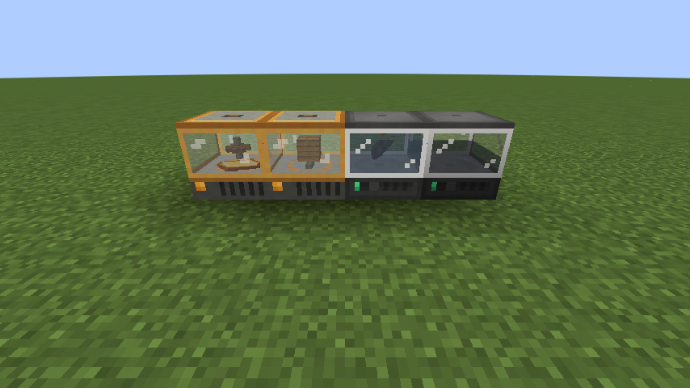
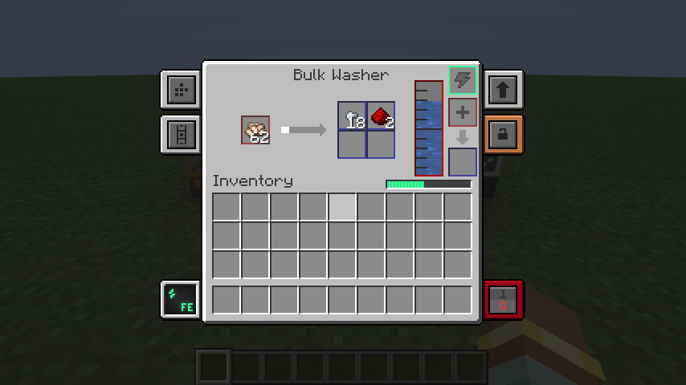
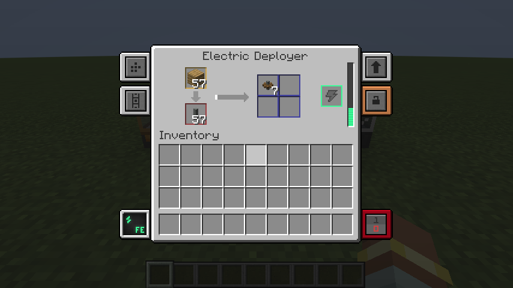

# Mekanism Create Machines

A NeoForge 1.21.1 add-on for **Mekanism** and **Create**. It adds single-block Mekanism machines that do Create's in-world processing, so you don't need to build fan, belt or depot setups:

* **Bulk Washer**: Create's *Bulk Washing* (an encased fan blowing through water)
* **Electric Deployer**: what a Create *Deployer* does to items on a belt or depot

| Requires | Version |
|---|---|
| Minecraft | 1.21.1 |
| NeoForge | 21.1.219+ |
| Mekanism | 10.7+ (built against 10.7.19.85) |
| Create | 6.0+ (built against 6.0.10) |



## Both machines

Both are built on **Mekanism's own machine framework**, so they behave like real Mekanism machines:

* the standard Mekanism GUI and tabs
* **Speed, Energy and Muffling upgrades** (Speed upgrades raise energy use, as on Mekanism's own machines)
* side configuration, transporter colour config and auto-eject
* redstone control, security/owner settings and comparator output
* Mekanism energy from cables, or any FE source
* they keep their energy, items, water, upgrades and config when wrenched or broken

Both use Mekanism's Nutritional Liquifier body. You can see what each machine is working on inside its glass section.

## Bulk Washer



* Runs every `create:splashing` recipe. This covers all Create washing recipes and any that other mods or datapacks add: crushed ores → nuggets, gravel → flint/iron, sand → clay, soul sand → quartz/gold, dye removal, and so on. Chance-based outputs roll exactly as they do in Create.
* The GUI is laid out like the Nutritional Liquifier: item input → progress → 4 output slots, a water gauge with a bucket fill slot, an energy slot, and a power bar.
* **Water**: it holds a 10,000 mB tank and uses 50 mB per item. You can fill it three ways:
  * pipe water into the **top** (the default side config)
  * right-click the block with a water bucket or any other fluid container
  * put a water bucket in the `+` slot of the GUI
* Water fills the glass, and the item being washed tumbles around in it.

## Electric Deployer



* **Top slot = the deployer's held item.** It gets applied onto the **bottom slot = the processed item**, and the results go to 4 output slots.
* Recipes are looked up exactly the way Create's Deployer does it, so all of these work:
  * `create:deploying` recipes (for example shaft + planks → cogwheel, and copper waxing/scraping)
  * automatable `create:item_application` recipes (for example stripped log + andesite alloy → andesite casing)
  * **sandpaper polishing** (sandpaper in the held slot loses durability instead of being used up)
  * the **deploying steps of Sequenced Assembly** (for example the steps of the Precision Mechanism). Feed the output back into the input slot, or pipe it to other machines for the non-deploying steps.
* The held item is used up unless the recipe says to keep it. Tools lose durability, and container remainders (such as empty buckets) go to the outputs.
* **Side config**: the held item uses Mekanism's orange **"extra"** slot type, so pipes can feed it from a different face than the processed item. By default the processed item goes in the left side, the held item in the bottom, outputs come out the right side, and the energy slot is on the back. You can change all of this in the side-config tab.
* The processed item lies on the brass plate inside the glass, and the held item presses down onto it while the machine runs.
* Its texture is an original Create andesite-and-brass take on the Liquifier body, so you can tell the two machines apart.

## Crafting

```
Bulk Washer                      Electric Deployer
G C G                            A C A
B X F                            G X D
G C G                            A C A

G = any glass block   C = basic control circuit   X = Mekanism steel casing
B = water bucket (you get the bucket back)   F = Create encased fan
A = Create andesite alloy   D = Create deployer
```

Both machines also show up in Mekanism's creative tab.

## Config

The config is a server config at `world/serverconfig/mekwasher-server.toml`:

| Section | Key | Default | Meaning |
|---|---|---|---|
| `bulk_washer` | `energyUsage` | 50 | base energy per tick (Mekanism units; same as the Crusher) |
| | `energyStorage` | 20000 | base energy buffer |
| | `ticksPerOperation` | 100 | base ticks per item, before Speed upgrades |
| | `waterCapacity` | 10000 | water tank size in mB |
| | `waterPerOperation` | 50 | mB used per item (0 means water is still required but not used up) |
| `electric_deployer` | `energyUsage` | 50 | base energy per tick |
| | `energyStorage` | 20000 | base energy buffer |
| | `ticksPerOperation` | 40 | base ticks per deploy, before Speed upgrades |

## Download

No need to build it yourself:

* **Latest jar:** the [`latest` release](../../releases/tag/latest) is rebuilt automatically on every push to `main`.
* **Any build:** open the [Actions tab](../../actions/workflows/build.yml), click a run, and download `mekwasher-jar` under *Artifacts*.

## Building

```bash
./gradlew build
```

The mod jar is `build/libs/mekwasher-1.21.1-1.1.0.jar`. Drop it into the `mods/` folder of the server **and** of every client, next to Mekanism and Create. Clients need it too because of the block, GUI and renderer.

Create and Mekanism are only compile-time dependencies (they come from Modrinth's maven). They are not bundled into the jar.

### Dev runs

```bash
./gradlew runGameTestServer   # automated in-game tests (washing, deploying, FE input, water from top, upgrades)
./gradlew runClient
./gradlew runServer
```

The game tests and the screenshot helper live in `mekwasher/gametest` and are left out of the built jar.
