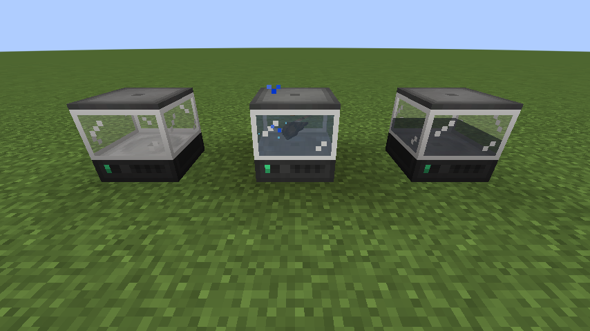

# Mekanism Bulk Washer

A small NeoForge 1.21.1 add-on for **Mekanism** and **Create**. It adds one machine, the **Bulk Washer**. It does the same job as Create's *Bulk Washing* (an encased fan blowing through water), but it is a single block, so you don't need a fan-and-water setup.

| Requires | Version |
|---|---|
| Minecraft | 1.21.1 |
| NeoForge | 21.1.219+ |
| Mekanism | 10.7+ (built against 10.7.19.85) |
| Create | 6.0+ (built against 6.0.10) |




## What it does

* Runs every `create:splashing` recipe. This covers all Create washing recipes and any that other mods or datapacks add: crushed ores → nuggets, gravel → flint/iron, sand → clay, soul sand → quartz/gold, dye removal, and so on. Chance-based outputs roll exactly as they do in Create.
* Built on **Mekanism's own machine framework**, so it acts like a real Mekanism machine:
  * the standard Mekanism GUI, laid out like the Nutritional Liquifier (item input → progress → 4 output slots, a water gauge with a bucket fill slot, an energy item slot, and a horizontal power bar)
  * **Speed, Energy and Muffling upgrades**
  * side configuration, transporter colour config and auto-eject
  * redstone control, security/owner settings and comparator output
  * Mekanism energy from cables, and any FE source (it shows up as an FE consumer)
  * keeps its energy, water, items, upgrades and config when wrenched or broken
* **Water**: it holds a 10,000 mB tank and uses 50 mB per item. You can fill it three ways:
  * pipe water into the **top** (the default side config; change it with the side-config tab)
  * right-click the block with a water bucket or any other fluid container
  * put a water bucket in the `+` slot of the GUI
* **Looks**: it uses Mekanism's Nutritional Liquifier body. Water fills the glass section, and the item being washed tumbles around inside it while the machine runs.

## Crafting

```
G C G      G = any glass block (c:glass_blocks)
B X F      C = basic control circuit (c:circuits/basic)
G C G      X = Mekanism steel casing
           B = water bucket (you get the bucket back)
           F = Create encased fan
```

The machine also shows up in Mekanism's creative tab.

## Config

The config is a server config at `world/serverconfig/mekwasher-server.toml`:

| Key | Default | Meaning |
|---|---|---|
| `energyUsage` | 50 | base energy per tick (Mekanism units; same as the Crusher) |
| `energyStorage` | 20000 | base energy buffer |
| `ticksPerOperation` | 100 | base ticks to wash one item, before Speed upgrades |
| `waterCapacity` | 10000 | water tank size in mB |
| `waterPerOperation` | 50 | mB used per item washed (0 means water is still required but not used up) |

## Building

```bash
./gradlew build
```

The mod jar is `build/libs/mekwasher-1.21.1-1.0.0.jar`. Drop it into the `mods/` folder of the server **and** of every client, next to Mekanism and Create. Clients need it too because of the block, GUI and renderer.

Create and Mekanism are only compile-time dependencies (they come from Modrinth's maven). They are not bundled into the jar.

### Dev runs

```bash
./gradlew runGameTestServer   # automated in-game tests (washing, FE input, water from top, upgrades)
./gradlew runClient
./gradlew runServer
```

The game tests and the screenshot helper live in `mekwasher/gametest` and are left out of the built jar.
